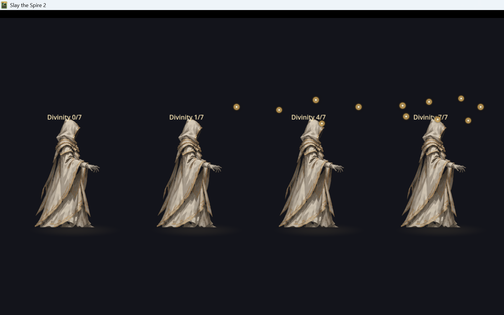

# M10.1：神性光球位置与转速调整

## 调整内容

根据反馈，光球环绕中心整体上移至头顶，并提高角速度：

| 参数 | 初版 | M10.1 | 最新 |
|---|---:|---:|---:|
| 环绕中心 Y | -252 | **-306** | **-306** |
| 横向半径 X | 108 | **102** | **102** |
| 纵向半径 Y | 40 | **28** | **28** |
| 角速度 | 0.16 rad/s | 0.21 rad/s | **0.32 rad/s** |
| 上下浮动幅度 | 2.5 px | **2.0 px** | **2.0 px** |

- 最新角速度约为初版的 2 倍，绕完一圈约 **19.6 秒**（此前 0.21 rad/s 时约 30 秒）。
- 仍然保持缓慢庄严的环绕，不是高速旋转。
- 光球数量同步、生成/消失、死亡/复活清理逻辑均未修改。

## 效果截图

0/7、1/7、4/7、7/7 数量仍分别对应 0、1、4、7 颗；7/7 的光球现在集中在头顶上方。

## 构建验证

- `dotnet build`：0 warning / 0 error
- `dotnet publish`：exit 0
- 部署：`Believer.dll` 1,902,592 B、`Believer.pck` 392,268 B
- 动态同步日志仍保持 `active == amount`

## 限制

截图仍为游戏内 dev 展示层（测试资源），真实战斗内站位/背景下的最终观感仍需实战确认。角色 PNG 仍是临时占位美术。
