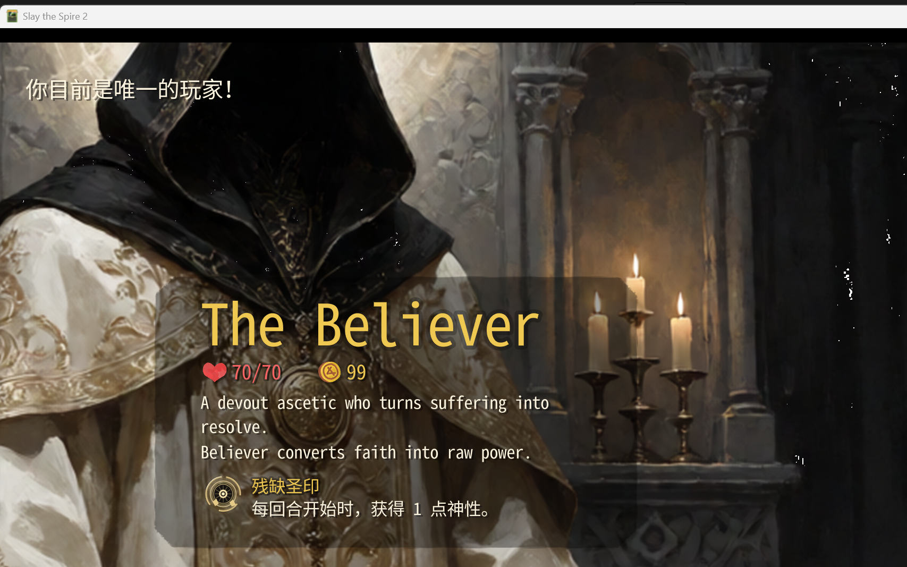
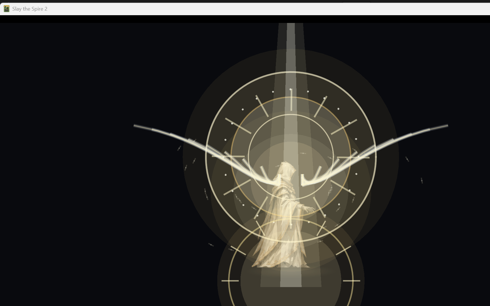

# M10.10：遗物 UI、全知全能新演出、触发卡中文化

## 1. 遗物 UI：残缺圣印

旧版使用通用 `relic.png` 占位图标。新版为 `INCOMPLETE_SEAL` 制作了独立圣印图标：

| 资源 | 路径 | 尺寸 |
|---|---|---:|
| 小图标 | `Believer/images/relics/incomplete_seal.png` | 94×94 |
| 大图标 | `Believer/images/relics/big/incomplete_seal.png` | 256×256 |
| UI 描边 | `Believer/images/relics/incomplete_seal_outline.png` | 94×94 |

图标为透明底的金色破碎圣印：残缺外环、象牙白核心、古金裂纹、下坠碎片与圣光。

同时新增中文本地化：

- `BELIEVER-INCOMPLETE_SEAL.title`：残缺圣印
- `BELIEVER-INCOMPLETE_SEAL.description`：每回合开始时，获得 1 点神性。
- `BELIEVER-INCOMPLETE_SEAL.flavor`：一枚残缺的圣印；祝福并不完整，却会在每个黎明回应你。

旧占位图已备份至 `Assets/CardArt/OriginalRelicUI/`。

游戏内验证：真实角色选择界面中，遗物栏已显示新的圣印图标与中文名称/描述：



## 2. 全知全能触发卡中文化

在 `Believer/localization/zhs/cards.json` 中补齐：

```text
BELIEVER-OMNISCIENCE_CARD.title       = 全知全能
BELIEVER-OMNISCIENCE_CARD.description = 仅当神性为 7 时才能打出。
                                        消耗 7 点神性：抽 3 张牌，移除自身所有负面状态，
                                        获得本局已解锁的全部神迹，并使卡牌费用变为 0。
                                        直到敌方回合结束前，你不会损失生命值。
```

运行时验证日志：

```text
[CardArtGallery] Omniscience title='全知全能'
```

说明中文本地化已被游戏实际加载，而不是只改了文件。

## 3. 新的全知全能演出：圣域炽翼

旧版“圣阳 + 闪电”演出已从运行时挂载中停用；新版改为 **圣域展开 + 炽翼升格**：

### 四段结构

| 阶段 | 时间 | 表现 |
|---|---:|---|
| 起势 | 0–0.36s | 地面圣印展开、神性光球上浮、身体辉光出现 |
| 升格 | 0.36–0.96s | 角色升空约 110px、背后巨型玫瑰窗圣环展开、两侧光翼张开、圣光柱降下 |
| 爆发 | 0.96–1.40s | 圣环/光翼全开、白金全屏爆闪、扩散冲击波、光羽爆发 |
| 持续 | 1.40s 后 | 悬空、圣环慢转、光翼呼吸、光羽环绕、脚下大型圣印持续发光 |

### 核心视觉

- 巨型玫瑰窗式圣环（非七重神环）
- 双侧展开的炽白光翼
- 从天而降的圣光柱
- 脚下旋转的圣印/祭坛
- 神性光球升格
- 全屏白金爆闪与冲击波
- 持续态光羽环绕
- 出牌时触发光翼脉冲 + 圣环闪耀
- 受击时保留圣盾/圣环反馈

实现：

```text
BelieverCode/Character/BelieverOmniscienceDomainVfx.cs
  BelieverOmniscienceDomainVfxLayer
  SeraphicHalo / SeraphicWings / SeraphicPillar
  SeraphicGround / SeraphicAura / SeraphicFeathers
  SeraphicShockwave / SeraphicOrb
```

旧版 `BelieverOmniscienceVfxAttachPatch` 已停用，避免双特效叠加。

游戏内 dev 视觉验证：

```text
[OmniscienceDomain] seraphic domain layer ready
[OmniscienceDomain] activation begin, orbs=7
```



## 4. 文件清单

```text
Believer/images/relics/incomplete_seal.png
Believer/images/relics/incomplete_seal_outline.png
Believer/images/relics/big/incomplete_seal.png
Believer/localization/zhs/cards.json              # 全知全能卡标题/描述
Believer/localization/zhs/relics.json             # 残缺圣印中文
BelieverCode/Character/BelieverOmniscienceDomainVfx.cs
BelieverCode/Character/BelieverOmniscienceVfx.cs  # 旧演出挂载停用
BelieverCode/Mechanics/Omniscience.cs              # 触发新演出
BelieverCode/Powers/OmnisciencePower.cs            # 出牌/受击新演出回调
BelieverCode/Dev/BelieverOmniscienceVfxTest.cs     # 新演出预览
BelieverCode/Dev/BelieverCardArtGallery.cs         # 全知全能标题运行时验证
Assets/CardArt/OriginalRelicUI/                    # 旧遗物图标备份
```

## 5. Build / Publish

- `dotnet build`：**0 warning / 0 error**
- `dotnet publish`：**exit 0**
- 正常启动（无测试标记）：通过；未注入 dev overlay

```text
Believer.dll    2,012,672 B
Believer.pck  104,476,904 B
Believer.pdb      185,984 B
Believer.json         366 B
```

## 6. 限制

1. 新演出已完成 dev 视觉验证与运行时无异常，但尚未在实际战斗中打出全知全能卡做完整实机 run 验证。
2. 遗物 UI 已验证真实角色选择界面的图标与中文；其他位置（奖励界面/遗物栏）使用同一图标资源，未逐个截图。
3. 全知全能卡中文标题已在运行时日志中确认，描述文本已写入同一 zhs 表。
4. 新演出为程序化 2D，无音效、无镜头震动。
5. 未提交 Git；新增/修改代码与资源保留在工作区。
