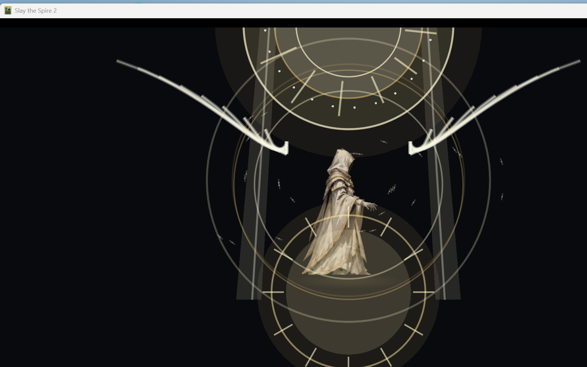

# M10.11：全知全能「升空」特效重做

> 重点修正：角色必须明显飞起，且所有大特效不能遮住人物轮廓。
> 本轮只改表现层；全知全能的无敌、0 费、持续时间、神性和卡牌逻辑未改。

## 1. 新演出结构

| 阶段 | 时间 | 表现 |
|---|---:|---|
| 起势 | 0–0.36s | 地面圣印展开、神性光球上浮、身体白金辉光 |
| 升格 | 0.36–0.96s | 角色升空约 215px、玫瑰窗圣环与双侧光翼展开、两侧圣光柱出现 |
| 爆发 | 0.96–1.40s | 圣环/光翼全开、全屏白金爆闪、扩散冲击波、光羽爆发 |
| 持续 | 1.40s 后 | 角色悬空、圣环慢转、光翼呼吸、光羽环绕、地面圣印保留 |

## 2. 防止遮住角色

- 圣环、光翼、圣光柱、地面圣印全部布置在人物**背后/轮廓之外**
- 中央人物区域保持空白，不再用大圆盘/中心光柱覆盖身体
- 光翼从左右两侧向外展开，内缘不穿过身体
- 圣环抬到头顶上方，不覆盖面容
- 仅保留少量前景光羽、环形冲击波和短促全屏爆闪
- 地面圣印做了位置补偿：角色升空时它仍留在地面，不会跟着角色飘起来

## 3. 升空效果

- visual root 升空 **215px**
- 升空过程使用平滑 ease，持续态保留轻微上下悬浮
- 地面圣印与角色之间形成清晰高度差
- 圣环/光翼随角色升空，形成“升格”而不是原地发光

## 4. 视觉验证

dev 视觉测试：

```text
[OmniscienceDomain] seraphic domain layer ready
[OmniscienceDomain] activation begin, orbs=7
```



截图中人物完整可见，圣环在上方、光翼在两侧，地面圣印在脚下。

## 5. 本轮同时保留的改动

### 遗物 UI

- `incomplete_seal.png` / `big/incomplete_seal.png` / `incomplete_seal_outline.png`
- 真实角色选择界面显示：新圣印图标 + “残缺圣印”中文文本


### 全知全能触发卡中文

- `BELIEVER-OMNISCIENCE_CARD.title` = 全知全能
- 中文描述已写入 `Believer/localization/zhs/cards.json`
- 运行时确认：`[CardArtGallery] Omniscience title='全知全能'`

## 6. Build / Publish

- `dotnet build`：**0 warning / 0 error**
- `dotnet publish`：**exit 0**
- 正常启动（无测试标记）：通过，无 dev overlay

```text
Believer.dll    2,012,672 B
Believer.pck  104,476,904 B
Believer.pdb      186,100 B
Believer.json         366 B
```

## 7. 限制

1. 使用 dev 视觉场景验证升空和遮挡关系；尚未在实际战斗中完整打出全知全能卡做实机 run 验证。
2. 当前演出为程序化 2D，无音效和镜头震动。
3. 遗物 UI 已在真实选人界面验证；其他界面共用同一资源。
4. 未提交 Git；改动保留在工作区。
