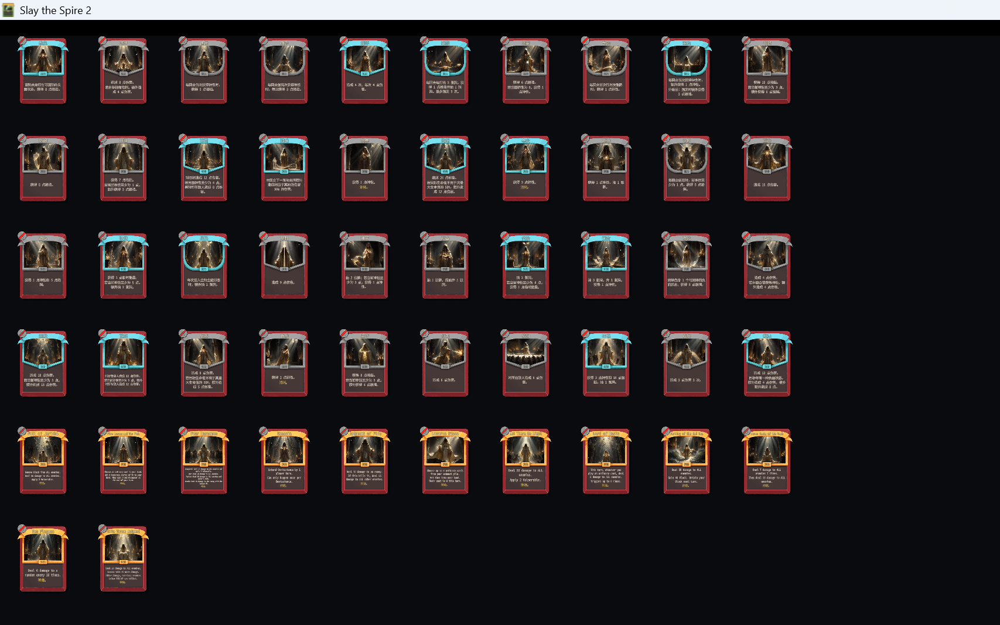

# M10.3：52 张正式卡图生成与接入报告

> 范围：40 张普通卡（Basic + Common + Uncommon）+ 12 张稀有神迹。
> 本轮**未生成、未接入强化神迹**（12 张留待下一阶段）。

## 1. 结果摘要

| 项目 | 结果 |
|---|---:|
| 正式卡图目标 | 52 |
| 已生成独立图片 | **52 / 52** |
| 已接入游戏目录 | **52 / 52** |
| big（1000×760） | 52 |
| small（250×190） | 52 |
| 缺失/失败 | **0** |
| Godot `.import` 新资源 | 106 个（52 big + 52 small + 2 个原占位图） |
| 游戏内卡面画廊加载 | **52 / 52，missing=0** |
| Build | **0 warning / 0 error** |
| Publish | **exit 0** |
| 游戏正常启动（无测试标记） | 通过 |
| 强化神迹 | 本轮未做 |

## 2. 生成方式

使用项目已有的 **Agnes AI 图像生成管线**（`Tools/AgnesImage/`，真实 API 已配置）：

```text
card_art.py --only <52 current card ids> --concurrency 2 --rpm 20 --sheet
```

生成结果：

- 52 个任务全部成功；
- 45 张新生成，7 张复用之前已验收的样张；
- 失败 0，取消 0；
- 单张约 13 秒；
- 所有生成图保持**无文字、无卡框、无费用/稀有度标记**的插画内容；
- 图像为 AI 概念插画，不是从旧总览图裁切放大。

## 3. 产物路径

### 源图（保留，便于后续精修）

```text
Assets/CardArt/Generated/Normal/<card_id_slug>.png     # 40 普通
Assets/CardArt/Generated/Miracles/<card_id_slug>.png   # 12 神迹
```

### 游戏实际使用路径

```text
Believer/images/card_portraits/big/<card_id_slug>.png  # 1000×760
Believer/images/card_portraits/<card_id_slug>.png      # 250×190
```

路径规则来自当前代码：

- `BelieverCard.CustomPortraitPath` → `big/<slug>.png`
- `BelieverCard.PortraitPath` → `<slug>.png`
- 缺失时回退：`images/card_portraits[/big]/card.png`

本轮没有修改路径逻辑，也没有修改任何卡牌效果、升级、稀有度、全知全能机制。

## 4. 12 张神迹映射

| card_id | 显示名 | 源图 | 游戏 big | 游戏 small | 状态 |
|---|---|---|---|---|---|
| BELIEVER-LET_THERE_BE_LIGHT | 要有光 | Generated/Miracles/let_there_be_light.png | card_portraits/big/let_there_be_light.png | card_portraits/let_there_be_light.png | 已接入 |
| BELIEVER-GENESIS | 再创世 | Generated/Miracles/genesis.png | card_portraits/big/genesis.png | card_portraits/genesis.png | 已接入 |
| BELIEVER-FOUR_HORSEMEN | 天启四骑士 | Generated/Miracles/four_horsemen.png | card_portraits/big/four_horsemen.png | card_portraits/four_horsemen.png | 已接入 |
| BELIEVER-PARTING_OF_THE_RED_SEA | 红海裂天 | Generated/Miracles/parting_of_the_red_sea.png | card_portraits/big/parting_of_the_red_sea.png | card_portraits/parting_of_the_red_sea.png | 已接入 |
| BELIEVER-TEN_PLAGUES | 十灾降世 | Generated/Miracles/ten_plagues.png | card_portraits/big/ten_plagues.png | card_portraits/ten_plagues.png | 已接入 |
| BELIEVER-FALL_OF_JERICHO | 耶城崩塌 | Generated/Miracles/fall_of_jericho.png | card_portraits/big/fall_of_jericho.png | card_portraits/fall_of_jericho.png | 已接入 |
| BELIEVER-JUDGMENT_OF_FIRE | 天火审判 | Generated/Miracles/judgment_of_fire.png | card_portraits/big/judgment_of_fire.png | card_portraits/judgment_of_fire.png | 已接入 |
| BELIEVER-SEVEN_SEALS | 羔羊七印 | Generated/Miracles/seven_seals.png | card_portraits/big/seven_seals.png | card_portraits/seven_seals.png | 已接入 |
| BELIEVER-FIVE_LOAVES_AND_TWO_FISH | 五饼二鱼 | Generated/Miracles/five_loaves_and_two_fish.png | card_portraits/big/five_loaves_and_two_fish.png | card_portraits/five_loaves_and_two_fish.png | 已接入 |
| BELIEVER-LAZARUS_RISES | 拉撒复生 | Generated/Miracles/lazarus_rises.png | card_portraits/big/lazarus_rises.png | card_portraits/lazarus_rises.png | 已接入 |
| BELIEVER-LORD_OF_HOSTS | 万军降临 | Generated/Miracles/lord_of_hosts.png | card_portraits/big/lord_of_hosts.png | card_portraits/lord_of_hosts.png | 已接入 |
| BELIEVER-WHITE_THRONE_JUDGMENT | 白座终审 | Generated/Miracles/white_throne_judgment.png | card_portraits/big/white_throne_judgment.png | card_portraits/white_throne_judgment.png | 已接入 |

完整 52 行映射（含 40 普通卡、文件存在性、验证状态）：

- [M10.3-CardArt-Mapping.csv](M10.3-CardArt-Mapping.csv)

## 5. 游戏内验证

新增 **dev-only 卡面画廊** `BelieverCardArtGallery`：

- 用真实 `ModelDb.AllCards` 取 52 张当前卡牌；
- 用真实 `NCard.Create` 创建卡面；
- 检查每张卡 `big`/`small` 资源存在性；
- 日志结果：

```text
[CardArtGallery] cards=52
...
[CardArtGallery] missing-art cards=0
```

实际游戏截图：



截图显示 52 张卡的卡框、卡名、描述和新卡图；普通卡与神迹卡均加载成功。  
完整 52 张展开图：[M10.3-52-cardart-contactsheet.png](images/M10.3-52-cardart-contactsheet.png)

## 6. Build / Publish / 部署

- `dotnet build Believer.csproj`：**0 warning / 0 error**
- `dotnet publish Believer.csproj -p:PublishProfile=FolderProfile`：**exit 0**
- 部署目录：`D:\1\steamapps\common\Slay the Spire 2\mods\Believer\`

```text
Believer.dll    1,922,048 B
Believer.pck   86,341,908 B
Believer.pdb       85,384 B
Believer.json         366 B
```

- Godot 导入：106 个 `.import`
- 正常启动（不带测试标记）：通过；没有 `CardArtGallery` 日志。

## 7. 尚未验证 / 限制

1. **未完成真实奖励界面、战斗手牌、放大预览、卡组浏览的逐项截图验证**。  
   已验证的是游戏客户端内真实 `NCard` 卡面画廊，52/52 资源加载且卡图、卡名、描述正常显示；奖励/手牌/预览流程仍应在实际 run 中再测。
2. 未进行卡牌打出、神迹实际使用、全知全能强化形态的运行时测试。
3. 强化神迹本轮没有生成或接入；12 个强化 ID 仍是占位图路径。
4. 生成图为 1000×760 / 250×190 的 AI 插画；部分普通卡构图较接近“站立信徒 + 圣光”，不是每张都达到理想动作差异；需要时可单张 `--only <slug> --force` 重生成。
5. 原 `Assets/CardArt/` 旧资源包完全保留；旧名不匹配的图片没有硬绑定。
6. 没有提交 Git；当前新增资源与开发测试代码保持工作区状态，未执行 reset/clean/stash。

## 8. 结论

- 52 张正式卡图：**已生成、已复制、已注册到 Godot 资源、已打进 PCK、已在游戏卡面中加载显示**。
- 缺失：**0**。
- 12 张强化神迹：**本轮未做**。
- 尚未完成真实奖励/手牌/预览流程的逐项验证，不能把这一部分标记为已通过。
