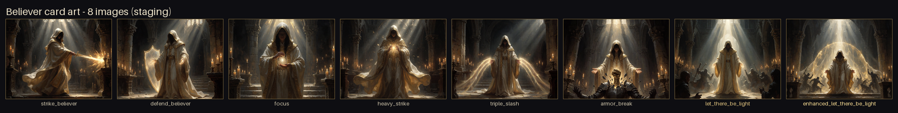

# M10.5 Agnes 生图能力接入

> 目标：把 Agnes AI 的图像生成能力接进 Believer 的卡图生产流程，让 M10.2.1 的 64 张正式卡图可以按规格表批量生成，并保持与游戏 `card_portraits` 路径/尺寸契约一致。
> 本阶段只接入生成管线并做样张验收，**未全量生成、未写入游戏资源目录、未修改任何 C# 代码**。

## 0. 结论

- Agnes 图像 API 已打通：密钥属**国际站**（`apihub.agnes-ai.com`），中国站 `api.agnes-ai.cn` 对同一密钥返回 401；客户端已内置自动换站。
- 实测模型：`agnes-image-2.5-flash` 文生图成功，请求 `1024x768` 实际返回 `1152x864` PNG，单张约 **12–14 秒**。
- 新增工具链 `Tools/AgnesImage/`：通用客户端 + 64 任务批处理 + 画风提示词 + 独立验收脚本。
- `card_art.py --all --dry-run` 展开 **64 个任务**（普通 40 / 神迹 12 / 强化 12），与 `M10.2.1-CardArt-Spec.csv` 一一对应。
- 已生成 **8 张真实样张**（focus / 打击 / 防御 / 重击 / 要有光 / 强化要有光，独立验收另生成 三连斩 / 破甲），其中 5 张批量生成 5/5 成功、78.1s；尺寸/模式/落盘/跳过逻辑均通过验收；独立验证 **PASS（9 项检查全部通过、0 缺陷）**，报告见 `docs/M10.5.1-AgnesVerification.md`，样张总览见 `docs/images/M10.5-agnes-cardart-samples.png`。
- 未做的事：全量 64 张生成、`--install` 写入游戏目录、Godot 导入 / `dotnet publish`、游戏内显示验证。

## 1. 需求背景

`docs/M10.2.1-CardArt-Spec.md` 明确当前有 64 行视觉需求（40 普通卡 + 12 普通神迹 + 12 强化神迹），
旧资源包是 512×512 的总览图裁切概念图，且 55 行无确认映射；目标路径为：

- `Believer/images/card_portraits/big/<slug>.png`（大卡图 1000×760）
- `Believer/images/card_portraits/<slug>.png`（小卡图 250×190）

`BelieverCode/Cards/BelieverCard.cs` 用 `Id.Entry.RemovePrefix().ToLowerInvariant()` 取 slug，
`StringExtensions.BigCardImagePath/CardImagePath` 在资源不存在时回退到 `card.png`。
因此只要按契约尺寸把 PNG 放到上述路径，游戏侧无需改代码；本次接入因此只做“生成能力”，不改代码。

## 2. API 契约（实测确认）

| 项目 | 值 |
|---|---|
| Endpoint（可用） | `POST https://apihub.agnes-ai.com/v1/images/generations` |
| Endpoint（同密钥不可用） | `POST https://api.agnes-ai.cn/v1/images/generations` → `401 无效的令牌` |
| 鉴权 | `Authorization: Bearer <API_KEY>` |
| 模型 | `agnes-image-2.5-flash`（另可用 `agnes-image-2.0-flash` / `agnes-image-2.1-flash`） |
| 必填参数 | `model`、`prompt`、`size`（`WxH`，如 `1024x768`，需为 16 的倍数） |
| 输出格式 | `extra_body.response_format = "url"`（默认拿 URL 再下载）或 `"b64_json"`；`return_base64: true` 亦可 |
| 图生图 | `extra_body.image: [url 或 data URI]`（当前不可用，见 §8） |
| 响应 | `data[0].url` 或 `data[0].b64_json`；`revised_prompt` 可能为空串 |
| 实测尺寸 | 请求 `1024x768` → 返回 `1152x864`（4:3），由管线裁切到 `1000x760` |

错误处理：`401` 换站；`429`（免费档约 20 RPM）、`408/409/500/502/503/504` 与网络错误按 2/4/8/16/32 秒退避重试；
`400/403/404/413/422` 直接失败并记录原因。客户端不会打印密钥或完整请求体。

## 3. 密钥与安全

- 密钥只存在 `Tools/AgnesImage/.env`（已加入 `.gitignore`），模板为 `.env.example`。
- 解析优先级：显式参数 > `AGNES_API_KEY` 环境变量 > `Tools/AgnesImage/.env` > 仓库根 `.env`。
- `git check-ignore` 确认 `.env` 与 `out/` 均被忽略；`git grep` 确认受版本控制的文件里没有密钥。
- manifest 只记录模型名、尺寸、提示词与耗时，不记录密钥。
- 换机器/协作时复制 `.env.example` 自行填写；**不要提交 `.env`**。

## 4. 工具结构

| 文件 | 作用 |
|---|---|
| `Tools/AgnesImage/agnes_client.py` | 通用 Agnes 客户端：文生图/图生图/多图、重试、换站、URL/b64 两种返回、`generate_to_file`；也可直接当 CLI 用 |
| `Tools/AgnesImage/card_art.py` | 64 任务批处理：读规格表 → 组提示词 → 调 API → 去留白 → 裁切 → 写大/小图 → manifest/接触表；支持 `--only/--limit/--force/--install/--dry-run/--concurrency/--rpm/--ref` |
| `Tools/AgnesImage/believer_style.py` | 统一画风常量 + 52 条逐卡英文场景（由 CSV `recommended_visual` 翻译）+ 三种变体（normal/miracle/enhanced）的 `build_prompt` |
| `Tools/AgnesImage/verify_pipeline.py` | 独立验收：任务覆盖、slug 规则、尺寸契约、manifest、幂等、密钥卫生、留白裁切 |
| `Tools/AgnesImage/README.md` | 上手命令与排错表 |
| `Tools/AgnesImage/.env` / `.env.example` | 本地密钥（忽略）/ 模板 |

## 5. 使用方式

```powershell
# DSH 内置 Python（PATH 里的 python 可能是应用商店占位符）
$PY = "C:\Users\Administrator\.dsh\dsh-runtimes\dsh-primary-runtime\dependencies\python\python.exe"
cd Tools\AgnesImage

& $PY card_art.py --all --dry-run                  # 64 个任务 + 提示词，不调 API
& $PY card_art.py --only BELIEVER-FOCUS --staging  # 生成 1 张到暂存
& $PY card_art.py --all --concurrency 2 --sheet    # 全量 64 张（约 8–15 分钟）
& $PY card_art.py --all --install                  # 写入游戏卡图目录（会覆盖同名 PNG）
& $PY card_art.py --only focus --force             # 单张重生成
```

- 默认输出到 `Tools/AgnesImage/out/card_art/{big,small}/`；`--install` 才写 `Believer/images/card_portraits/`。
- 已存在且尺寸正确的图默认跳过；`--force` 重新生成。
- 每张生成/失败都会追加到 `Tools/AgnesImage/out/manifest.jsonl`（JSONL，含 `original_size`、`content_bbox`、`bars_trimmed`、`elapsed_s`、`prompt_version`）。
- `--sheet` 生成接触表便于人工抽检。

## 6. 关键实现细节

### 6.1 留白条自动裁切（实测缺陷修复）

Agnes 偶发返回“请求 4:3、但画面只占中间一条”的画布：实测 `let_there_be_light` 首张为 1152×864，
内容仅 x=271..880（610×864 竖图），两侧是均值约 238、标准差 0–2 的浅灰条。
若直接 cover-fit 会把灰条留在卡图里，因此 `card_art.normalize_artwork()` 先做：

1. 逐列/逐行统计 RGB 均值与标准差；`min(通道均值) > 225` 且 `max(通道标准差) < 25` 判为留白条；
2. 只裁四边连续留白，且要求：单侧 ≤ 边长 45%、内容面积 ≥ 原图 40%、内部不存在均匀亮条、
   内容不是整体高亮（保护合法的全亮画面）；
3. 再 `ImageOps.fit` 到 1000×760（LANCZOS），小图由大图直接缩到 250×190；
4. 裁切信息写入 manifest，便于回溯。

### 6.2 画风与提示词

- 统一画风：黑暗哥特教堂奇幻、绘画感卡图、神圣金色体积光、象牙白袍 + 金边、面部藏在阴影；
- 后缀强制“满幅构图、无留白条”，并排除文字/卡框/费用/稀有度/水印；
- 强化神迹 = 对应普通神迹的主体与构图 + 白金光/金环/升腾光幕（当前为纯文生图版本，见 §8）；
- 提示词版本写入 manifest（当前 `m10.2.1-v1`），便于重生成时对比。

## 7. 本次验收记录

| 项目 | 结果 |
|---|---|
| 密钥连通性 | 中国站 401 → 国际站 `GET /v1/models` 200、`POST /v1/images/generations` 200 |
| 模型清单 | 10 个模型，其中图像模型 3 个（2.0/2.1/2.5-flash） |
| 首张文生图 | 1163 KB PNG，12.7s，返回 1152×864，主题为兜帽信徒 + 哥特教堂 + 神圣金光 |
| 留白裁切 | 真实缺陷样张 1152×864 → 内容 bbox x=271..880 → 输出干净 1000×760 |
| 任务展开 | `--all --dry-run`：64 个任务（普通 40 / 神迹 12 / 强化 12），0 warning，0 文件写入 |
| 单张生成 | `--only BELIEVER-FOCUS --staging`：13.8s，big 1000×760 RGB / small 250×190 RGB，manifest 1 行 |
| 幂等 | 同命令重跑：0.47s，跳过，不调 API，manifest 不新增 |
| 5 张批量 | `--only "BELIEVER-STRIKE_BELIEVER,BELIEVER-DEFEND_BELIEVER,BELIEVER-HEAVY_STRIKE,BELIEVER-LET_THERE_BE_LIGHT,BELIEVER-ENHANCED_LET_THERE_BE_LIGHT" --staging --concurrency 1`：**5/5 成功**，78.1s，全部 1000×760 / 250×190 RGB，无留白 |
| 样张集 | 共 8 张：`Tools/AgnesImage/out/card_art/{big,small}/` + `contact_sheet.png`；总览另存 `docs/images/M10.5-agnes-cardart-samples.png` |
| 独立验收 | [M10.5.1-AgnesVerification.md](M10.5.1-AgnesVerification.md)：64 任务清单、dry-run、尺寸契约、manifest、幂等、密钥卫生、留白裁切、视觉抽检共 9 项 **全部 PASS、0 缺陷** |



> 样张只写入 gitignored 暂存目录，未写入 `Believer/images/card_portraits/`。

## 8. 未完成 / 已知限制

- **未全量生成 64 张**，只生成了样张集；全量命令已就绪，需人工抽检后再跑。
- **未执行 `--install`**，游戏卡图目录没有任何新增/覆盖；因此“游戏内已显示新卡图”为 0。
- 未做 Godot 资源导入与 `dotnet publish`：新增 PNG 需要 Godot 导入生成 `.import` 并打包进 `.pck` 后才会被游戏加载。
- **图生图当前不可用**：平台对所有 img2img 请求（Data URI / 公网 URL / 不同模型与参数形态）都返回
  `503 image queue is full`；因此强化神迹目前用纯文生图生成“同主题强化版”，不是从基础图派生的严格同构图。
  接口恢复后可用 `card_art.py --ref <基础图> --only <enhanced_id> --force` 重新派生。
- 画风一致性只能靠提示词约束；需要更强一致性时用 `--ref`（待图生图恢复）。
- 未做游戏内截图验证；本阶段不声明任何“已接入游戏”的结论。

## 9. 下一步

1. 人工抽检样张（`out/card_art/contact_sheet.png`），确认画风/构图/无文字；
2. 全量生成：`python card_art.py --all --concurrency 2 --sheet`（约 8–15 分钟，13s/张）；
3. 对不合格的单张 `--only <slug> --force` 重生成；
4. 确认后 `--install` → Godot 导入 → `dotnet build` / `dotnet publish` → 游戏内验证；
5. 图生图恢复后，用基础神迹图 `--ref` 派生 12 张强化图，替换当前的纯文生图版本。
