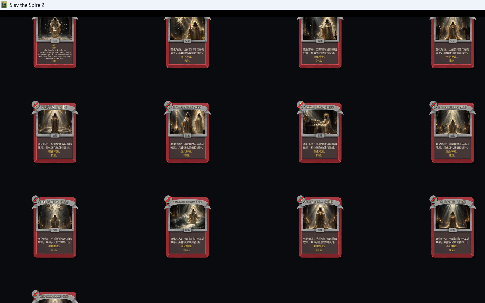
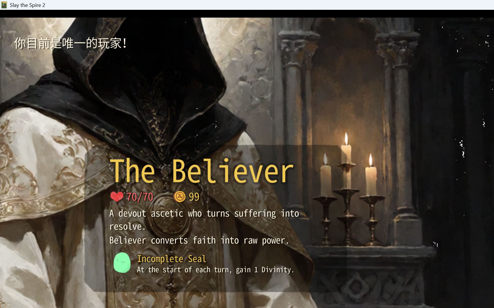
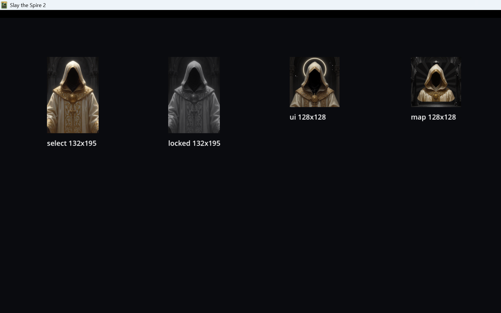

# M10.6：缺失美术资源补齐与接入报告

> 范围：全知全能触发卡、12 张强化神迹、角色选人立绘、角色头像/地图头像。
> 未修改任何卡牌效果、升级、稀有度、全知全能机制。

## 1. 缺失资源清单与结果

| 资源 | 修复前 | 结果 |
|---|---|---|
| 全知全能触发卡 `BELIEVER-OMNISCIENCE_CARD` | 无专属卡图 | **1/1 已生成并接入** |
| 12 张强化神迹 | 无专属强化图 | **12/12 已生成并接入** |
| 角色选人界面大立绘 / 背景 | 使用 Ironclad 占位背景 | **1/1 已生成并接入** |
| 选人界面头像 | 旧占位图 | **已替换** |
| UI 小头像 | 旧占位图 | **已替换** |
| 锁定选人头像 | 旧占位图 | **已替换** |
| 地图头像 | 旧占位图 | **已替换** |
| 缺失 / 失败 | — | **0** |

## 2. 全知全能触发卡

- 真实卡牌类：`BelieverCode/Cards/OmniscienceCard.cs`
- 真实 card_id：`BELIEVER-OMNISCIENCE_CARD`
- 显示名：`Omniscience` / 全知全能
- 源图：`Assets/CardArt/Generated/Character/omniscience_card.png`
- 游戏卡图：
  - `Believer/images/card_portraits/big/omniscience_card.png`（1000×760）
  - `Believer/images/card_portraits/omniscience_card.png`（250×190）

画面内容：腾空信徒、七重神环、7 个神性光球、白金圣光、地面圣印。

## 3. 12 张强化神迹映射

| card_id | 显示名 | 源图 | 游戏 big | 状态 |
|---|---|---|---|---|
| BELIEVER-ENHANCED_LET_THERE_BE_LIGHT | 要有光（强化） | Generated/Miracles/enhanced_let_there_be_light.png | card_portraits/big/enhanced_let_there_be_light.png | 已接入 |
| BELIEVER-ENHANCED_GENESIS | 再创世（强化） | Generated/Miracles/enhanced_genesis.png | card_portraits/big/enhanced_genesis.png | 已接入 |
| BELIEVER-ENHANCED_FOUR_HORSEMEN | 天启四骑士（强化） | Generated/Miracles/enhanced_four_horsemen.png | card_portraits/big/enhanced_four_horsemen.png | 已接入 |
| BELIEVER-ENHANCED_PARTING_OF_THE_RED_SEA | 红海裂天（强化） | Generated/Miracles/enhanced_parting_of_the_red_sea.png | card_portraits/big/enhanced_parting_of_the_red_sea.png | 已接入 |
| BELIEVER-ENHANCED_TEN_PLAGUES | 十灾降世（强化） | Generated/Miracles/enhanced_ten_plagues.png | card_portraits/big/enhanced_ten_plagues.png | 已接入 |
| BELIEVER-ENHANCED_FALL_OF_JERICHO | 耶城崩塌（强化） | Generated/Miracles/enhanced_fall_of_jericho.png | card_portraits/big/enhanced_fall_of_jericho.png | 已接入 |
| BELIEVER-ENHANCED_JUDGMENT_OF_FIRE | 天火审判（强化） | Generated/Miracles/enhanced_judgment_of_fire.png | card_portraits/big/enhanced_judgment_of_fire.png | 已接入 |
| BELIEVER-ENHANCED_SEVEN_SEALS | 羔羊七印（强化） | Generated/Miracles/enhanced_seven_seals.png | card_portraits/big/enhanced_seven_seals.png | 已接入 |
| BELIEVER-ENHANCED_FIVE_LOAVES_AND_TWO_FISH | 五饼二鱼（强化） | Generated/Miracles/enhanced_five_loaves_and_two_fish.png | card_portraits/big/enhanced_five_loaves_and_two_fish.png | 已接入 |
| BELIEVER-ENHANCED_LAZARUS_RISES | 拉撒复生（强化） | Generated/Miracles/enhanced_lazarus_rises.png | card_portraits/big/enhanced_lazarus_rises.png | 已接入 |
| BELIEVER-ENHANCED_LORD_OF_HOSTS | 万军降临（强化） | Generated/Miracles/enhanced_lord_of_hosts.png | card_portraits/big/enhanced_lord_of_hosts.png | 已接入 |
| BELIEVER-ENHANCED_WHITE_THRONE_JUDGMENT | 白座终审（强化） | Generated/Miracles/enhanced_white_throne_judgment.png | card_portraits/big/enhanced_white_throne_judgment.png | 已接入 |

12 张强化图均为**独立 AI 生成图**，不是普通图套金色滤镜，也不是拼图或裁切总览。
每张也导出了 250×190 小图。

## 4. 角色立绘与头像

### 选人界面背景/大立绘

- 源图：`Assets/CardArt/Generated/Character/believer_select.png`
- 游戏图片：`Believer/images/character/select/believer_select.png`（1920×1080）
- 场景：`Believer/scenes/char_select_bg_believer.tscn`
- 代码：`Believer.CustomCharacterSelectBg` 指向该场景
- 画面：暗色教堂中 3/4 身兜帽信徒，象牙白袍、古金纹饰、圆形圣徽、隐藏面容；右侧留出选人信息面板空间。

### 头像

| 用途 | 游戏路径 | 尺寸 | 状态 |
|---|---|---:|---|
| 选人界面头像 | `Believer/images/charui/char_select_char_name.png` | 132×195 | 已加载 |
| 锁定选人头像 | `Believer/images/charui/char_select_char_name_locked.png` | 132×195 | 已加载 |
| UI 小头像 | `Believer/images/charui/character_icon_char_name.png` | 128×128 | 已加载 |
| 地图头像 | `Believer/images/charui/map_marker_char_name.png` | 128×128 | 已加载 |

旧占位图已备份到：`Assets/CardArt/OriginalCharUI/`，未删除原图。

## 5. 游戏内验证

### 5.1 全知全能卡 + 12 强化神迹

使用真实 `NCard` 卡面画廊加载 13 张额外卡（1 全知全能 +12 强化）：

```text
[CardArtGallery] extra=True cards=13
[CardArtGallery] extra=True missing-art cards=0
```



### 5.2 角色选人界面

实际创建并进入游戏原生 `NCharacterSelectScreen`，选中 Believer：

```text
[CharSelectPreview] selected BELIEVER-BELIEVER
  bg=res://Believer/scenes/char_select_bg_believer.tscn
[CharSelectPreview] asset exists=True path=.../char_select_char_name.png
[CharSelectPreview] asset exists=True path=.../char_select_char_name_locked.png
[CharSelectPreview] asset exists=True path=.../character_icon_char_name.png
[CharSelectPreview] asset exists=True path=.../map_marker_char_name.png
```



### 5.3 四种头像资源

游戏内 `ResourceLoader` 加载结果全部 `loaded=True`：



## 6. Build / Publish / 部署

- `dotnet build Believer.csproj`：**0 warning / 0 error**
- `dotnet publish Believer.csproj -p:PublishProfile=FolderProfile`：**exit 0**
- 部署目录：`D:\1\steamapps\common\Slay the Spire 2\mods\Believer\`
  - `Believer.dll`：1,929,216 B
  - `Believer.pck`：104,414,156 B
  - `Believer.pdb`：86,856 B
  - `Believer.json`：366 B
- 无测试标记正常启动：通过；没有 dev overlay 注入。

## 7. 文件清单

新增/修改：

```text
BelieverCode/Character/Believer.cs                       # 覆盖 CustomCharacterSelectBg
Believer/scenes/char_select_bg_believer.tscn             # 选人背景场景
BelieverCode/Dev/BelieverCardArtGallery.cs               # 增加 13 张额外卡画廊模式
BelieverCode/Dev/BelieverCharacterSelectPreview.cs       # 真实选人界面 dev 预览
BelieverCode/Dev/BelieverCharacterIconTest.cs            # 四种头像加载预览
Assets/CardArt/Generated/Character/                       # 角色源图
Assets/CardArt/Generated/Character/_source/               # 生成原图
Assets/CardArt/Generated/Miracles/enhanced_*.png          # 12 强化源图
Assets/CardArt/OriginalCharUI/                            # 原头像备份
Believer/images/character/select/believer_select.png      # 选人背景图
Believer/images/charui/char_select_char_name.png         # 选人头像
Believer/images/charui/char_select_char_name_locked.png  # 锁定头像
Believer/images/charui/character_icon_char_name.png      # UI 小头像
Believer/images/charui/map_marker_char_name.png          # 地图头像
Believer/images/card_portraits/big/enhanced_*.png        # 12 强化大图
Believer/images/card_portraits/enhanced_*.png            # 12 强化小图
Believer/images/card_portraits/big/omniscience_card.png  # 全知全能大图
Believer/images/card_portraits/omniscience_card.png      # 全知全能小图
```

完整 18 行映射（13 卡 +5 角色资源）：

- [M10.6-MissingArt-Mapping.csv](M10.6-MissingArt-Mapping.csv)

## 8. 未完成 / 限制

1. **未在真实战斗/真实全知全能流程中打出** Omniscience 卡或强化神迹；卡面是在游戏内真实 `NCard` 画廊中验证。
2. 选人界面已实际进入并选中 Believer；**UI 小头像在顶部栏/存档位的实际布局**未单独截图，只用游戏内 ResourceLoader 和头像预览验证了资源加载。
3. 12 张强化图是独立 AI 生成素材，仍属于原型质量；部分构图可能与普通神迹相近，但并非套色滤镜。
4. 选人背景为静态场景，没有额外 Spine/动画；符合本轮“缺失资源补齐”范围。
5. 未提交 Git；新增资源和 dev 验证代码保留在工作区，未执行 reset/clean/stash。

## 9. 结论

- 全知全能触发卡：**已接入并显示**
- 12 张强化神迹：**12/12 已接入并显示**
- 选人立绘/背景：**已接入，真实选人界面已验证**
- 选人/UI/地图/锁定头像：**4/4 已加载**
- 失败/缺失：**0**
