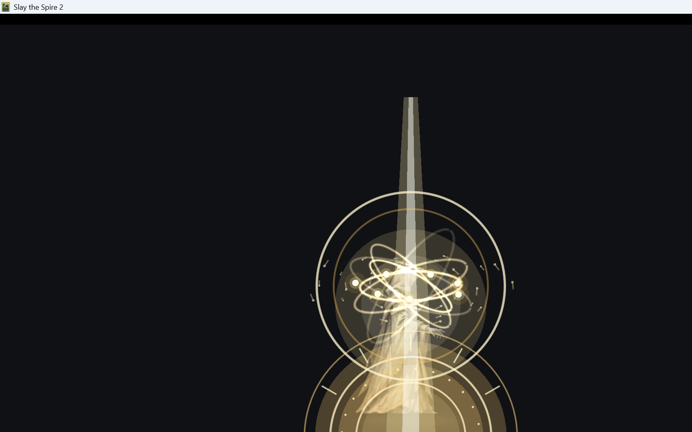
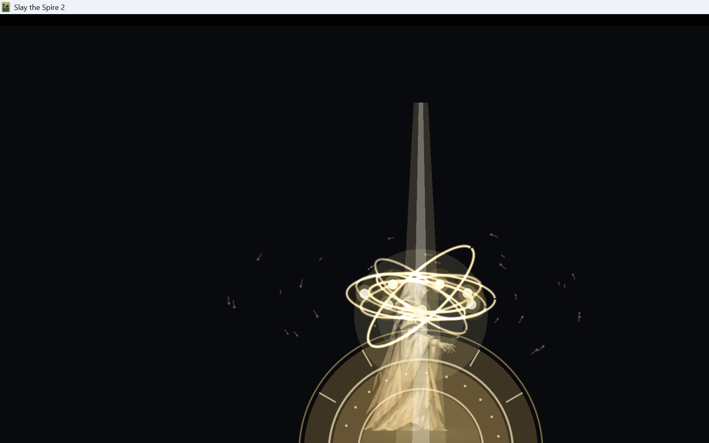

# M10.7：全知全能形态完整 2D 演出

> 纯 2D、低成本、可运行版本。未修改卡牌数值、费用、稀有度、神性消耗或全知全能持续时间。
> 演出层挂在 Believer 现有的 `BelieverEffectLayer` 上，不替换角色 Spine/立绘。

## 1. 实现结果

| 阶段 | 时长 | 实现 |
|---|---:|---|
| 蓄势 | 0–0.42s | 小型圣印出现并脉冲、7 个神性光球从外圈聚拢、身体白金辉光渐强 |
| 升格 | 0.42–1.02s | 角色缓慢悬浮、圣印扩张、第 1–3 层神环展开、光柱降下 |
| 爆发 | 1.02–1.50s | 七重神环全部展开、光球高速公转并点亮、全屏白闪、冲击波、神圣几何/经文粒子 |
| 持续 | 1.50s 后 | 角色轻微悬浮、七环慢速旋转、光球环绕、地面大圣印持续发光 |

总启动演出目标 **约 1.5 秒**，与需求一致。  
光球数量 = 启动时神性数量，最多 **7 个**。

## 2. 视觉组成

全部由 Godot 2D 节点和 `_Draw` 绘制，不新增 3D 资源：

- `OmniscienceSeal`：地面多层圣印、圆环、放射线、光点
- `OmniscienceRing` ×7：椭圆神环、金/白双线、Additive 混合
- `OmniscienceEnergyOrb` ×7：核心光球 + 外层光晕，蓄势聚拢、持续环绕
- `OmniscienceLightPillar`：升格/爆发阶段的白金光柱
- `OmniscienceBodyGlow`：角色身体周围的白金辉光
- `OmniscienceShockwave`：爆发/出牌/格挡冲击环
- `OmniscienceParticles`：神圣几何短线和光点粒子
- `CanvasLayer` 全屏白闪：爆发瞬间的高亮闪屏
- 角色悬浮：对 current visual root 做轻微 Y 轴偏移，结束时恢复

持续阶段：

- 七环慢速旋转
- 光球持续环绕
- 圣印脉冲
- 角色轻微悬浮呼吸
- 出牌时调用 `PlayCardBurst()` 触发白金拖尾/圣光爆发
- 受击时调用 `ShieldFeedback()` 触发小型圣盾/圣印闪光

## 3. 接入位置

### 启动触发

`BelieverCode/Mechanics/Omniscience.cs`：

- 在 `Activate()` 消耗神性后、应用 `OmnisciencePower` 前调用
  `BelieverOmniscienceVfx.Begin(player, divinityAmount)`；
- 只在本地视觉层存在时生效，不改变战斗状态；
- 若视觉层未及时挂载，`_Process` 检测 `OmnisciencePower` 出现时以 7 个光球回退启动。

### 视觉层挂载

`BelieverCode/Character/BelieverOmniscienceVfx.cs`：

- Harmony postfix `NCreature._Ready`
- 只在 Believer 玩家的 visual root 上挂载
- 与现有 `BelieverDivinityOrbLayer` 并列放在 `BelieverEffectLayer`

### 持续态出牌 / 受击

`BelieverCode/Powers/OmnisciencePower.cs` 只增加视觉回调：

- `AfterCardPlayed` → `CardPlayed()`（同一 owner 的卡牌）
- `AfterDamageReceived` → `ShieldFeedback()`（target 是 owner）
- 不改变 `ModifyHpLostAfterOsty`、费用、清理、手牌上限或持续时间逻辑。

## 4. 游戏内视觉验证

dev-only 测试标记：`user://believer_omniscience_vfx_test.flag`

测试日志：

```text
[OmniscienceVfx] layer ready
[OmniscienceVfx] activation begin, divinity=7
[OmniscienceVfxTest] sequence started with 7 orbs
[OmniscienceVfx] card-play trail burst
[OmniscienceVfx] shield feedback
```

爆发/七环/圣印/光柱：



持续态：



## 5. Build / Publish

- `dotnet build`：**0 warning / 0 error**
- `dotnet publish`：**exit 0**
- 游戏正常启动（无测试标记）：通过；没有 dev overlay 注入
- 部署：

```text
Believer.dll    1,965,568 B
Believer.pck  104,414,492 B
Believer.pdb      134,528 B
Believer.json         366 B
```

## 6. 机制安全性

- 未修改任何卡牌伤害/格挡/费用/升级/稀有度
- 未修改全知全能持续时间、0 费、清除 debuff、无敌逻辑
- 未修改卡牌生成与清理
- 新增的 `AfterCardPlayed`/`AfterDamageReceived` 只调用视觉层
- 视觉层完全 client-side；若未挂载，战斗逻辑保持原样
- 原 `OmnisciencePower` 的 HP 拦截继续提供“本回合无敌”效果

## 7. 已知限制

1. 本轮验证是 **dev 视觉画廊 + 真实 Godot 节点渲染**，不是实际战斗中打出全知全能卡的完整实机 run；实际战斗触发仍需最终实机确认。
2. 全屏白闪在截图采样时可能已淡出；代码中在爆发阶段触发。
3. 角色悬浮使用 visual root 的 Y 偏移，未替换 Spine 动画；极端 animation 情况下可能需要再做层级适配。
4. 没有增加音效；需求未要求。
5. 未提交 Git；新增视觉代码和 dev 测试保持工作区状态。

## 8. 文件

```text
BelieverCode/Character/BelieverOmniscienceVfx.cs       新增 VFX 层与全部 2D 绘制
BelieverCode/Mechanics/Omniscience.cs                  启动时触发 VFX
BelieverCode/Powers/OmnisciencePower.cs                出牌/受击视觉回调
BelieverCode/Dev/BelieverOmniscienceVfxTest.cs         dev 视觉验证
docs/images/M10.7-omniscience-vfx-burst.png            爆发/神环/圣印截图
docs/images/M10.7-omniscience-vfx-sustain.png          持续态截图
```
