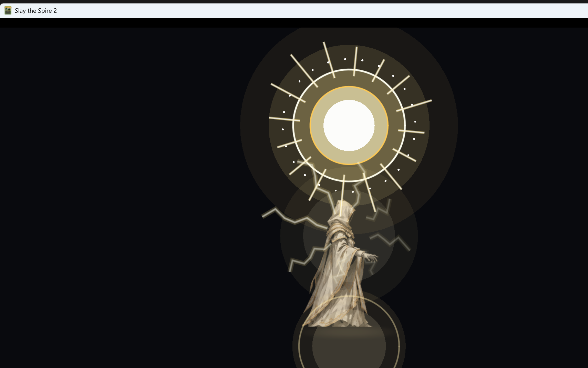
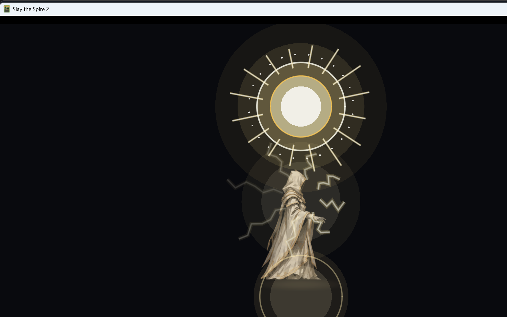

# M10.8：全知全能「圣阳 + 白金闪电」重制版

> 本版按新方向重做，**取消七重神环作为主核心**。
> 核心视觉改为：角色飞天、全身白金色闪电、背后上方神圣太阳、爆闪与持续圣阳。
> 仅改视觉层与视觉回调；卡牌数值、费用、全知全能持续时间、无敌逻辑均未改。

## 1. 四段演出

| 阶段 | 时间 | 内容 |
|---|---:|---|
| 起势 | 0–0.38s | 脚下圣光扩散、神性光球从地面向上浮、身体出现细小电弧 |
| 飞天 | 0.38–1.00s | 角色升空约 105px、闪电增加到全身 8 道并缠绕、背后太阳从暗到亮、太阳光芒展开 |
| 爆发 | 1.00–1.40s | 太阳全开、全身闪电爆亮、白金色全屏爆闪、14 道闪电向外炸开、神圣冲击波 |
| 持续 | 1.40s 后 | 角色悬空、太阳持续悬浮在背后上方、8 道低频闪电流动、身体白金辉光；出牌触发闪电拖尾/太阳脉冲，受击触发圣盾闪光 |

总启动时长约 **1.4 秒**，在需求的 1.2–1.5 秒范围内。

## 2. 新核心视觉

- **神圣太阳**：角色背后上方，白热核心 + 金色日冕 + 16 道放射光线 + 24 个光点；
- **白金色闪电**：8 道环绕身体的锯齿电弧，不使用单道落雷；
- **飞天**：visual root 从地面上升约 105px，持续态保持悬空并微幅呼吸；
- **爆闪**：全屏 CanvasLayer 白闪；
- **冲击波/爆发闪电**：14 道径向闪电 + 扩散圆环；
- **神性光球**：起势阶段按启动神性数量上浮，最多 7 个，进入飞天/持续后淡出；
- **出牌**：太阳脉冲 + 闪电拖尾/冲击波；
- **受击**：小型圣盾/太阳闪光反馈。

全部为 **2D 程序化绘制**，无外部太阳/闪电贴图依赖，避免新增资源导入风险和运行时纹理开销。

## 3. 实现文件

```text
BelieverCode/Character/BelieverOmniscienceVfx.cs
  BelieverOmniscienceVfxLayer      四段状态机 / 飞天 / 太阳 / 闪电 / 爆闪
  OmniscienceSun                   背后上方圣阳
  OmniscienceLightningBolt         环绕身体闪电
  OmniscienceLightningBurst        爆发时向外炸开的闪电
  OmniscienceGroundGlow            起势地面圣光
  OmniscienceBodyGlow              持续身体辉光
  OmniscienceShockwave             神圣冲击波
  OmniscienceEnergyOrb             起势阶段神性光球
  BelieverOmniscienceVfx           静态注册/触发
  BelieverOmniscienceVfxAttachPatch 挂载到 BelieverEffectLayer

BelieverCode/Mechanics/Omniscience.cs
  Activate() 在消耗神性后、应用 Power 前触发 Begin()

BelieverCode/Powers/OmnisciencePower.cs
  AfterCardPlayed -> 闪电拖尾/太阳脉冲
  AfterDamageReceived -> 圣盾反馈
```

## 4. 游戏内视觉验证

dev 测试标记：`user://believer_omniscience_vfx_test.flag`

日志：

```text
[OmniscienceVfx] lightning-sun layer ready
[OmniscienceVfx] sun activation begin, divinity=7
[OmniscienceVfxTest] sequence started with 7 orbs
[OmniscienceVfx] card lightning trail / sun pulse
[OmniscienceVfx] sacred shield feedback
```

爆发/升空/圣阳/全身闪电：



持续态：



## 5. Build / Publish

- `dotnet build`：**0 warning / 0 error**
- `dotnet publish`：**exit 0**
- 正常启动（无测试标记）：通过，未注入 dev overlay

部署：

```text
Believer.dll    1,963,008 B
Believer.pck  104,414,492 B
Believer.pdb      133,136 B
Believer.json         366 B
```

## 6. 机制安全

- 未改卡牌数值、费用、升级、稀有度、抽牌/生成/消耗规则
- 未改神性消耗与全知全能持续时间
- 未改 `ModifyHpLostAfterOsty` 的无敌实现
- 新增 Power 回调仅调用视觉层
- 若 VFX 层未挂载，战斗逻辑保持原状

## 7. 限制

1. 视觉验证使用 dev-only 场景 + 真实 Godot 节点渲染，尚未在实际战斗中完整打出全知全能卡进行实机 run 验证。
2. 圣阳/闪电为程序化 2D 绘制，不是外部高清贴图；后续可替换为正式美术贴图而无需改状态机。
3. 全屏爆闪在截图采样时可能已淡出；代码在爆发阶段触发。
4. 未加入音效。
5. 未提交 Git；新增/修改代码保持工作区状态。
