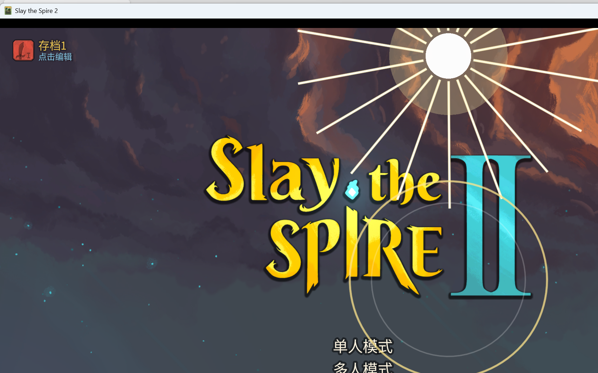

# M10.9：十二神迹独立特效

> 本轮为 12 张神迹增加独立的 2D 出牌演出，同时覆盖普通神迹与全知全能强化神迹。
> 未修改任何伤害、费用、卡牌生成、稀有度或全知全能机制。

## 1. 触发方式

在 `MiracleCard` 与 `EnhancedMiracleCard` 中重写：

```csharp
public override Task OnEnqueuePlayVfx(Creature? target)
{
    BelieverMiracleVfx.Play(this, target);
    return Task.CompletedTask;
}
```

这是游戏原生的 `CardModel.OnEnqueuePlayVfx` 视觉接口，在**出牌入队/鼠标释放瞬间**触发，不影响 `OnPlay` 的实际效果结算。

- 普通神迹：`MiracleCard` 统一继承
- 强化神迹：`EnhancedMiracleCard` 统一继承
- 仅本地玩家播放，避免多人重复特效
- 效果结束后自动释放 CanvasLayer，不残留节点

## 2. 十二种独立演出

| card_id | 视觉主题 |
|---|---|
| BELIEVER-LET_THERE_BE_LIGHT | 顶部降下白金圣光、放射光线、目标冲击环 |
| BELIEVER-GENESIS | 时间圆环、旋转刻度、蓝金宇宙光 |
| BELIEVER-FOUR_HORSEMEN | 四角四种颜色的骑士轨迹汇聚到目标 |
| BELIEVER-PARTING_OF_THE_RED_SEA | 两侧蓝色水墙分开、中央金色通道 |
| BELIEVER-TEN_PLAGUES | 十个灾祸光球从天空依次坠落 |
| BELIEVER-FALL_OF_JERICHO | 号角弧波、城墙块崩落 |
| BELIEVER-JUDGMENT_OF_FIRE | 目标位置垂直天火柱、火星四散 |
| BELIEVER-SEVEN_SEALS | 七层金印依次展开并点亮 |
| BELIEVER-FIVE_LOAVES_AND_TWO_FISH | 五饼二鱼光环、三张光页复制品 |
| BELIEVER-LAZARUS_RISES | 地下复生光柱、上升绿色圣光粒子 |
| BELIEVER-LORD_OF_HOSTS | 天穹多道天使长矛/光翼俯冲 |
| BELIEVER-WHITE_THRONE_JUDGMENT | 白色宝座光台、审判光柱与终审圆环 |

强化形态使用同一主题，但光效强度、尺寸和持续时间增强（约 1.65s）；普通形态约 1.45s。

## 3. 实现文件

```text
BelieverCode/Miracles/BelieverMiracleVfx.cs
  - 神迹主题映射
  - CanvasLayer / 目标位置解析
  - 12 种程序化 2D 绘制
  - 自动生命周期清理

BelieverCode/Miracles/MiracleCard.cs
  - OnEnqueuePlayVfx 统一触发普通神迹演出

BelieverCode/Miracles/EnhancedMiracleCard.cs
  - OnEnqueuePlayVfx 统一触发强化神迹演出

BelieverCode/Dev/BelieverMiracleVfxTest.cs
  - dev-only 12 种演出轮播验证
```

效果使用 `_Draw`、`DrawLine`、`DrawArc`、`DrawCircle`、`DrawColoredPolygon` 和 Additive CanvasItemMaterial，无外部纹理依赖。

## 4. 验证结果

dev 标记：`user://believer_miracle_vfx_test.flag`

运行日志：

```text
[MiracleVfxTest] queued 12 Miracle VFX previews
[MiracleVfxTest] Light effect started
[MiracleVfxTest] Genesis effect started
[MiracleVfxTest] FourHorsemen effect started
[MiracleVfxTest] RedSea effect started
[MiracleVfxTest] TenPlagues effect started
[MiracleVfxTest] Jericho effect started
[MiracleVfxTest] Fire effect started
[MiracleVfxTest] SevenSeals effect started
[MiracleVfxTest] Loaves effect started
[MiracleVfxTest] Lazarus effect started
[MiracleVfxTest] Hosts effect started
[MiracleVfxTest] WhiteThrone effect started
```

**12/12 演出路径均执行，运行时异常 0。**

单张视觉验证（要有光）：



## 5. Build / Publish

- `dotnet build`：**0 warning / 0 error**
- `dotnet publish`：**exit 0**
- 正常启动（无测试标记）：通过，未注入 dev overlay

部署：

```text
Believer.dll    1,981,952 B
Believer.pck  104,414,804 B
Believer.pdb      143,012 B
Believer.json         366 B
```

## 6. 限制

1. 已完成 12 种演出的工作室预览和运行时无异常验证；未在实际战斗 UI 中逐个打出 12 张神迹进行截图验证。
2. 目标位置来自战斗 creature 节点的 canvas 坐标；实际战斗镜头/分辨率变化下位置可能需要微调。
3. 效果为程序化 2D，不含音效和屏幕震动。
4. 未提交 Git；新增代码保持工作区状态。
