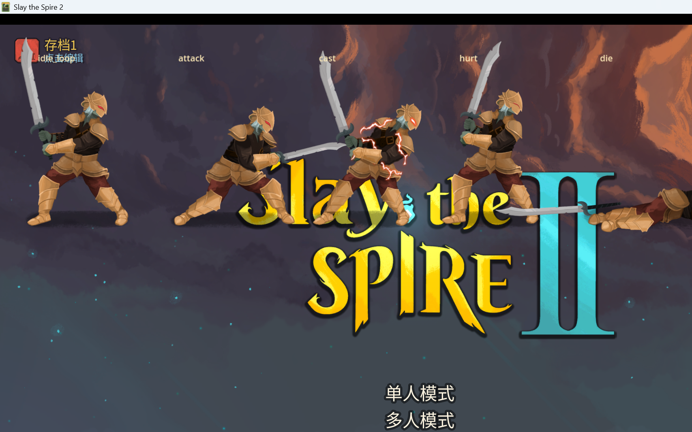

# M9-A3.1：信徒切换 Ironclad 原生角色模型验证

> 本阶段只验证 Ironclad 原生模型接入；未制作白袍金纹贴图，未修改正式信徒角色逻辑、卡牌、神性、神迹、遗物、初始卡组或全知全能逻辑。

## 1. 修改前检查

- 分支：`main`
- HEAD：`b740bee`（M9-A2.1 checkpoint）
- 工作区已有未提交修改（A2.3/A2.6/A2.7 相关）；本阶段全部保留，未执行 reset、clean、stash 或整目录覆盖。
- 参考图实际存在：
  - `Assets/Reference/神秘金饰长袍祭司姿态设定集.png`
  - `Assets/Reference/暗影圣职者角色设定稿.png`
  - `Assets/Reference/Believer_Model_Reference.png` **不存在**（以 `暗影圣职者角色设定稿.png` 作为当前模型参考）。

## 2. 当前信徒视觉创建方式

`Believer` 继承 BaseLib `PlaceholderCharacterModel`：

```csharp
public class Believer : PlaceholderCharacterModel
```

BaseLib 的 `PlaceholderCharacterModel` 默认：

```csharp
public virtual string PlaceholderID => "ironclad";
public override string CustomVisualPath =>
    SceneHelper.GetScenePath("creature_visuals/" + PlaceholderID);
```

`Believer` 当前未覆盖 `PlaceholderID`、`CustomVisualPath` 或 `CreateCustomVisuals()`，因此：

- **正式游戏中的信徒当前已经使用 Ironclad 原生占位场景**。
- A2/A2.3 的 Silent 换皮代码是 `SilentReskinTest` 开发覆盖层，**不是正式角色视觉**。
- 本阶段新增独立 dev-only 测试入口，直接加载 Ironclad 原生场景；未修改 `Believer.cs`。

## 3. Ironclad 原生资源（实际检查结果）

| 项目 | 结果 |
|---|---|
| 角色场景 | `res://scenes/creature_visuals/ironclad.tscn` |
| 骨架数据 | `res://animations/characters/ironclad/ironclad_skel_data.tres` |
| 骨架文件 | `res://animations/characters/ironclad/ironclad.skel` |
| Spine 版本 | **4.2.43** |
| 骨架规模 | **84 bones / 71 slots / 1 skin / 68 attachments** |
| 约束 | **6 IK**，0 Transform/Path/Physics |
| 动画 | `attack`, `attack_heavy`, `cast`, `die`, `hurt`, `idle_loop`, `relaxed_loop`, `weak_loop` |
| 图集 | 4 页：`ironclad.png` 1000×269、`ironclad_2.png` 632×82、`ironclad_3.png` 260×153、`ironclad_4.png` 17×42，scale 0.32；约 196 regions |
| 场景缩放/偏移 | SpineSprite `scale 0.28`，`position (5,-19)` |
| Bounds | `-121..121 / -278..0` |
| CenterPos / IntentPos | `(4,-168)` / `(30,-310)` |

游戏内实际日志确认：

```
[BelieverIronclad] native data=SpineSkeletonDataResource path=res://animations/characters/ironclad/ironclad_skel_data.tres
[BelieverIronclad] skeleton_file_res=SpineSkeletonFileResource atlas_res=SpineAtlasResource
[BelieverIronclad] native animations: attack, attack_heavy, cast, die, hurt, idle_loop, relaxed_loop, weak_loop
[BelieverIronclad] native scene loaded: res://scenes/creature_visuals/ironclad.tscn
```

Mod 可以正常读取 Ironclad 的原生场景、骨架和图集，无需修改游戏原始文件。

## 4. 独立测试入口

新增文件：

- `BelieverCode/Dev/BelieverIroncladTest.cs`（+ `.uid`）

行为：

- 只在 `user://believer_ironclad_test.flag` 存在时激活；正常游戏启动不显示测试内容。
- 通过 `ResourceLoader.Load` 加载原生 Ironclad skeleton data。
- 通过 `PreloadManager.Cache.GetScene("res://scenes/creature_visuals/ironclad.tscn")` 加载原生角色场景。
- 在测试覆盖层中实例化 5 份原生 Ironclad，分别播放：
  `idle_loop / attack / cast / hurt / die`。
- 每次播放后读取实际 current animation 并写日志。
- 不修改正式信徒角色、卡牌、战斗逻辑、原生 Ironclad 场景或资源。

测试标记已在测试结束后删除；当前正常启动不会出现测试覆盖层。

## 5. 游戏内截图

五份原生 Ironclad 动画截图：



可观察到：

- 原生 Ironclad 角色正常显示，无缺失纹理、无资源加载错误。
- 场景缩放/定位正常（5 份并排显示）。
- `idle_loop / attack / cast / hurt / die` 均可实际播放；日志中 current 名称分别为对应动画名。
- 原版 Ironclad/Silent 资源未被修改；只读取和实例化。
- 未修改卡牌、神性、神迹、遗物、初始卡组和全知全能逻辑。

## 6. Build / Publish / 部署

- `dotnet build Believer.csproj`：**0 warning / 0 error**
- `dotnet publish Believer.csproj -p:PublishProfile=FolderProfile`：**exit 0**
- 部署文件：
  - `Believer.dll`：1,395,200 B
  - `Believer.pdb`：57,840 B
  - `Believer.pck`：234,844 B
  - `Believer.json`：366 B
- 测试入口 C# 已进入 DLL；PCK 不额外包含 Ironclad 测试场景（本测试直接读取游戏原生场景，未打包副本）。
- 无测试标记的正常启动验证通过：M8/M9 既有日志正常，未出现 `[BelieverIronclad]` 覆盖层。

## 7. 尚未解决的问题

1. **本阶段只验证原生模型接入**：截图中的角色仍是原生 Ironclad，不是信徒白袍贴图；M9-A3.2 才制作信徒专属图集/皮肤。
2. 正式 `Believer` 目前仍依赖 `PlaceholderCharacterModel` 的 Ironclad 原生视觉；尚未创建信徒专属 Ironclad 场景、自定义 SkeletonDataResource 或 `CustomVisualPath`。
3. Ironclad 的武器/盔甲/头部区域需要在后续阶段规划隐藏、重绘或替换；本阶段未改图集。
4. 未在真实战斗流程中验证站位/敌人遮挡；本次为主菜单测试覆盖层验证。
5. `Believer_Model_Reference.png` 尚未生成；当前以 `暗影圣职者角色设定稿.png` 作为设计参考。

## 8. 下一阶段建议

- M9-A3.2：以 Ironclad 原生骨架/动画为基础，创建信徒专属的 Ironclad 皮肤图集（白袍、兜帽、金纹、圣徽），不覆盖原版 Ironclad。
- 在信徒自己路径下创建独立视觉场景/数据资源，通过 `CustomVisualPath` 或 `CreateCustomVisuals()` 接入正式角色；保留现有 placeholder 作为回退。
- 重新验证 `idle_loop / attack / cast / hurt / die`，并在真实战斗场景检查位置、缩放、遮挡和资源加载。
