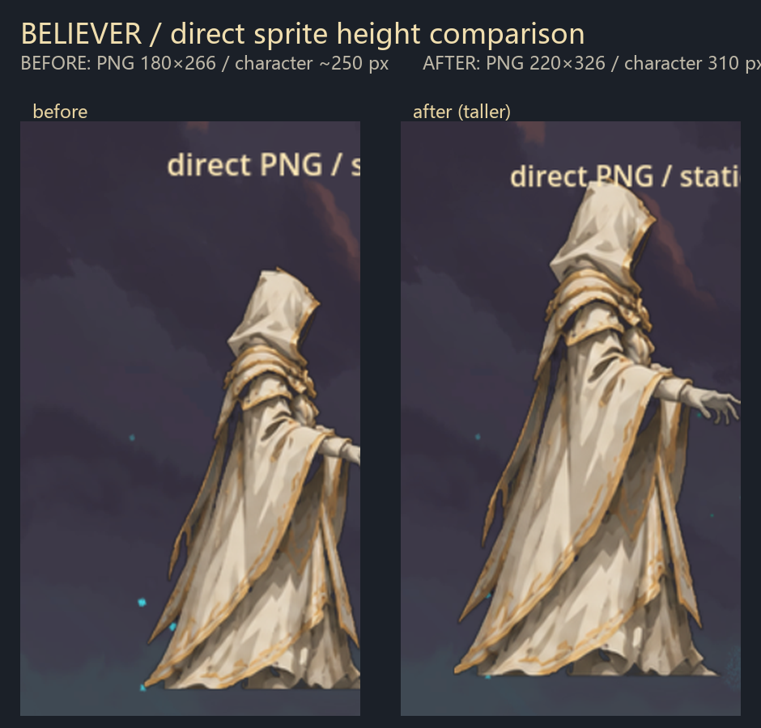
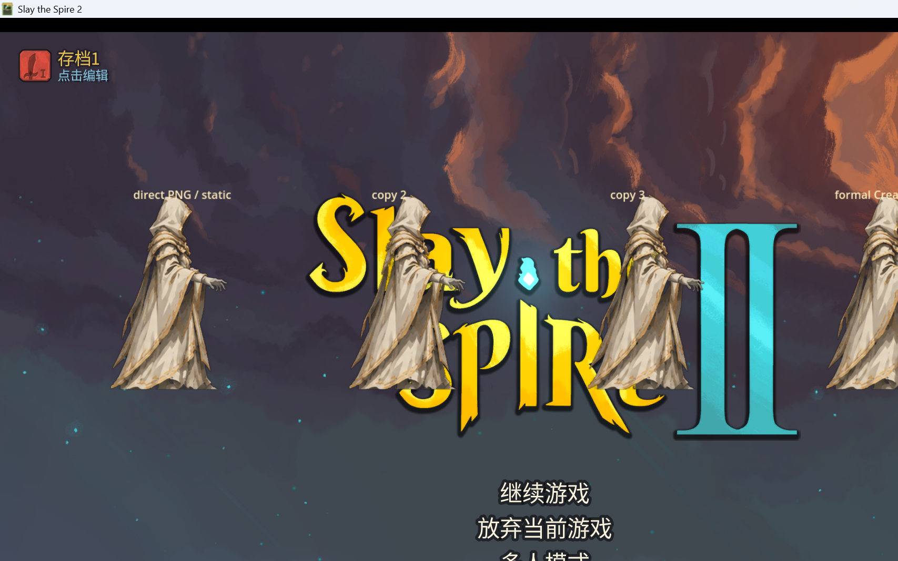

# M9-A4.1：直接贴图角色放大（更高大形象）

> 根据反馈，将直接贴图模式的信徒单角色 PNG 整体拉高，强化“高大、威严”的战斗剪影。
> 未修改卡牌、神性、12 张神迹、遗物、初始卡组、全知全能逻辑或原版 Ironclad/Silent 资源。

## 修改内容

- 角色 PNG 由约 **180×266** 调整为 **220×326**（实际角色高度约 **310 px**，此前约 250 px）。
- 保持透明背景、侧身朝右、兜帽/长袍/金边/圣徽设计。
- 仅替换 `Believer/images/characters/believer_direct.png`；直接贴图代码（`BelieverDirectVisuals` / `Believer.CreateCustomVisuals`）不变。
- PNG 作为 EmbeddedResource 重新打入 DLL；正式角色视觉仍使用直接 PNG。

## 对比图



- 左：旧版约 250 px。
- 右：新版约 310 px，整体更高大。

## 游戏内验证截图



日志确认：

```text
[BelieverDirect] loaded PNG 220x326
[BelieverDirect] NCreatureVisuals created: Node2D
[BelieverDirectTest] formal Believer.CreateCustomVisuals => Node2D
```

## Build / Publish / 部署

- `dotnet build`：**0 warning / 0 error**
- `dotnet publish`：**exit 0**
- 部署：
  - `Believer.dll`：1,835,520 B
  - `Believer.pdb`：59,816 B
  - `Believer.pck`：364,144 B
  - `Believer.json`：366 B
- 无测试标记正常启动不受影响；dev 测试标记已删除。

## 修改文件

- `Believer/images/characters/believer_direct.png`（替换为更高的临时占位图）
- `docs/images/M9A4.1-direct-texture-taller.png`
- `docs/images/M9A4.1-taller-before-after.png`
- 本报告

代码与 csproj 不需要新增改动（PNG 已通过 EmbeddedResource 随 DLL 构建）。

## 限制

- 该 PNG 仍是从模型参考图侧视图裁切、去背景得到的**临时占位图**，不是最终手绘美术。
- 当前仍未进入真实战斗场景验证（环境无法自动完成菜单/角色选择/战斗输入）；已通过 dev 覆盖层验证显示与正式接口。
- 仍是静态贴图，无待机/攻击/施法/受击/死亡动画。
- 角色变大后，正式战斗中的 Bounds/站位/血条/意图位置仍需实机确认。
