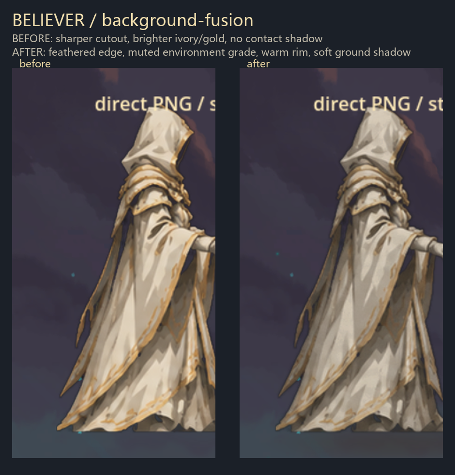

# M9-A4.2：信徒直接贴图角色背景融合精修

> 阶段目标：让直接贴图的信徒更自然地融入战斗画面，而不是继续重画角色。
> 未修改卡牌、神性、12 张神迹、遗物、初始卡组和全知全能逻辑；未覆盖原版 Ironclad/Silent 资源。

## 1. 修改前后



- 左：A4.1，边缘较硬、白袍/金边偏亮、无接地阴影。
- 右：A4.2，边缘柔化、色调压低、加入暖色环境边、脚下软阴影。

游戏内验证截图：[M9A4.2-background-fusion.png](images/M9A4.2-background-fusion.png)

## 2. 实际处理

### 2.1 脚下柔和接地阴影

- 新增 `Believer/images/characters/believer_shadow.png`：
  - RGBA 软椭圆；
  - 深灰褐色（约 `#40382E`），不使用纯黑；
  - 径向渐变 + Gaussian 模糊，边缘柔和；
  - 半透明，避免夸张黑斑。
- `BelieverDirectVisuals` 在 `NCreatureVisuals` 中新增 `Sprite2D`：
  - 位置在角色脚下 `(0,-2)`；
  - 缩放约 `0.80 × 0.34`；
  - 放在子节点最前，绘制在角色后方；
  - 不修改 Bounds、站位或动画逻辑。
- 日志确认：`[BelieverDirect] ground shadow added`。

### 2.2 弱化边缘贴图感

- 对 PNG alpha 做轻微羽化（Gaussian blur 约 1.15），只处理边缘，不整体模糊角色。
- 在剪影边缘加入少量半透明环境色 fringe，避免锐利白边/黑边。
- 保留袍角、披风的自然不规则边缘，没有强行统一成硬轮廓。

### 2.3 统一色调与环境色

- 整体轻微降低饱和度和亮度，避免白袍“纯白跳出来”。
- 暗部向暖灰环境色靠拢，降低纯黑对比。
- 金色装饰略降饱和度与亮度，避免过亮发光；圣徽仍保留可读性。
- 右侧轮廓加入很轻的暖色环境边（呼应背景暖光），左侧略偏冷；不是一整圈描边。
- 增加极轻的统一噪点/纹理，降低“图片贴上去”的干净感。
- 下摆做轻微环境压暗，增加垂坠感。
- 没有整体模糊角色或背景，也没有添加七重神环、神球、升空、圣印等全知全能特效。

### 2.4 光照方向

- 轻微左上主光、右下回落；
- 兜帽内部保持稳定深黑；
- 金色边与圣徽保留局部提亮，但不做独立发光。

## 3. 游戏内验证

测试标记：`user://believer_direct_texture_test.flag`（测试后删除）。

实际日志：

```text
[BelieverDirect] loaded PNG 220x326
[BelieverDirect] ground shadow added
[BelieverDirect] NCreatureVisuals created: Node2D
[BelieverDirectTest] formal Believer.CreateCustomVisuals => Node2D
[BelieverDirectTest] direct PNG overlay added
```

观察到：

- 角色透明背景正常。
- 接地阴影已显示在脚下，大小与人物基本协调，不是大黑斑。
- 角色白袍/金边不再过亮，边缘比旧版柔和。
- 正式 `CreateCustomVisuals()` 仍正常返回直接贴图 Node2D。
- 无 SpineSprite 依赖；原版 Ironclad/Silent 资源未修改。
- 无测试标记正常启动不显示测试角色。

## 4. Build / Publish / 部署

- `dotnet build`：**0 warning / 0 error**
- `dotnet publish`：**exit 0**
- 部署：
  - `Believer.dll`：1,871,360 B（含阴影纹理与直接贴图逻辑）
  - `Believer.pdb`：60,052 B
  - `Believer.pck`：385,812 B
  - `Believer.json`：366 B

## 5. 修改文件

- `Believer/images/characters/believer_direct.png` — 背景融合色调/边缘精修
- `Believer/images/characters/believer_shadow.png` — 新增软接地阴影
- `BelieverCode/Character/BelieverDirectVisuals.cs` — 增加阴影节点
- `Believer.csproj` — 将 shadow PNG 作为 EmbeddedResource
- `docs/images/M9A4.2-background-fusion.png`
- `docs/images/M9A4.2-before-after.png`
- 本报告

## 6. 限制与待办

1. 当前角色 PNG 仍是从模型参考侧视图裁切、去背景得到的**临时占位图**，不是最终手绘美术。
2. 环境色调是按当前主菜单/测试背景调的；实际战斗背景在不同章节/房间可能不同，需要在真实战斗场景确认，必要时再微调。
3. 当前环境无法自动完成菜单/角色选择/战斗输入，所以**尚未截取真实战斗场景截图**；本阶段验证基于游戏内 dev 覆盖层和正式 `CreateCustomVisuals()`。
4. 角色仍为静态贴图，没有待机/攻击/施法/受击/死亡动画。
5. 阴影位置/大小在真实战斗站姿下可能需要微调；目前保持独立 Sprite2D，后续可单独调整而不动角色 PNG。
6. 全知全能特效未开始；后续光球、神环、升空、圣印应作为独立节点叠加。
