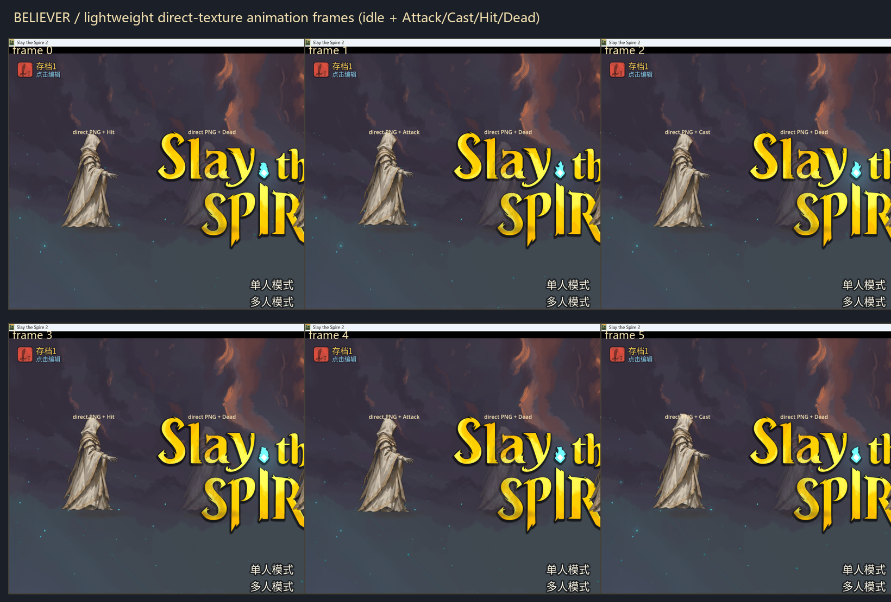

# M9-A4.3：直接贴图角色的轻量动画

> 本阶段保留直接贴图路线，不切回 Spine，不修改卡牌、神性、12 张神迹、遗物和全知全能逻辑。
> 动画全部通过位置、缩放、轻微旋转、透明度/闪白和独立节点实现。

## 1. 当前节点结构

BaseLib 的 `NodeFactory<NCreatureVisuals>` 从 PNG 生成的节点为：

```text
NCreatureVisuals (Node2D)
├─ Bounds (Control)
├─ Visuals (Sprite2D)          ← 信徒 PNG
├─ BelieverGroundShadow        ← 接地阴影
├─ BelieverDirectAnimator      ← 轻量动画控制器
└─ BelieverEffectLayer         ← 预留：神性光球/神环/圣印
```

没有 SpineSprite；`BelieverDirectAnimator` 直接控制 `Visuals` 的本地基准变换，不移动 Bounds/hitbox。
`BelieverEffectLayer` 目前为空，只作为 M10/M11 的独立特效层预留。

## 2. 轻量动画实现

### Idle Float

- 周期：**1.6 s**
- 上下幅度：**3 px**
- 轻微缩放呼吸：约 **±0.6%**
- 只做上下，不做左右大幅摆动。
- 基准位置/缩放/旋转/颜色在 `_Ready` 中保存；每帧从基准重新计算，不累加。

### Attack Pulse / Lunge

- 时长：**0.24 s**
- 朝右前方短冲 **+8 px**，随后快速回位；
- 轻微上抬 **-1.5 px**；
- 缩放 **+1.8%**；
- 轻微前倾 **约 0.012 rad**；
- 初始短暂亮度提升，不添加武器或大型特效。

### Cast Lift / Pulse

- 时长：**0.42 s**
- 上提 **-9 px**，再回落；
- 放大 **+2.8%**；
- 轻微反向倾斜约 **-0.006 rad**；
- 短暂受光增强；
- 与攻击区分：更慢、更“抬升”，不是前冲。

### Hurt Shake

- 时长：**0.15 s**
- 向左后方短促位移 **约 5.5 px**，叠加快速衰减抖动；
- 短暂闪白；
- 结束立即回到基准变换，不影响 Idle 基准。

### Die Fade / Sink

- 时长：**0.65 s**
- 向下沉 **13 px**；
- 缩小 **10%**；
- 淡出到约 **18% 透明度**；
- 与受击明显区分：更慢、有结束感；
- 死后再收到 Attack/Cast/Hit 不会打断死亡状态。

### 阴影同步

- 角色上下浮动或升降时，脚下阴影缩放做 **最多 6%** 的轻微同步；
- 阴影不跟随角色水平位移，不产生“影子飞走”。

## 3. 战斗事件接入

原版 `CreatureAnimator` 只对 Spine 存在；直接贴图没有 Spine，因此新增两个 Harmony 后置补丁：

- `NCreature.SetAnimationTrigger`：
  - `Attack` → 攻击
  - `Cast` / `PowerUp` → 施法
  - `Hit` → 受击
  - `Dead` → 死亡
- `NCreature.AnimShake`：
  - 作为无 Spine 场景下受击/震动反馈的兜底，触发 `Hit`。

补丁只转发到 `BelieverDirectAnimator`，不修改战斗逻辑、伤害、卡牌或神性系统。

## 4. 防止漂移/累计

- `_basePosition`、`_baseScale`、`_baseRotation`、`_baseModulate` 在就绪时保存；
- Idle 和 Attack/Cast/Hurt/Dead 都基于基准计算，不基于上一帧；
- 新动作触发时重置 `_actionTime`，从基准重新开始；
- 动作结束自动回到 `None`，下一帧仅保留 Idle；
- Death 设置 `_dead`，阻止后续普通动作覆盖死亡状态；
- 无 Tween 累积属性，无重复触发导致的位移/缩放叠加。

## 5. 游戏内验证

验证标记：`user://believer_direct_texture_test.flag`（测试后删除）。

实际日志：

```text
[BelieverDirectAnim] animator ready basePos=(0, -163) baseScale=(1, 1)
[BelieverDirectAnim] trigger=Attack action=Attack
[BelieverDirectAnim] trigger=Cast action=Cast
[BelieverDirectAnim] trigger=Hit action=Hurt
[BelieverDirectAnim] trigger=Dead action=Dead
```

截图/帧：



单帧截图：[M9A4.3-lightweight-animations.png](images/M9A4.3-lightweight-animations.png)

可见：

- 左侧副本循环 Attack/Cast/Hit；
- 第二副本触发 Dead 后淡出并下沉；
- 右侧副本保持 Idle；
- 正式 `Believer.CreateCustomVisuals()` 仍返回直接贴图 Node2D；
- 无 SpineSprite 依赖。

## 6. Build / Publish / 部署

- `dotnet build`：**0 warning / 0 error**
- `dotnet publish`：**exit 0**
- 部署：
  - `Believer.dll`：1,880,576 B
  - `Believer.pdb`：67,096 B
  - `Believer.pck`：385,980 B
  - `Believer.json`：366 B
- 无测试标记正常启动验证通过；不显示测试角色/动画覆盖层。

## 7. 修改文件

- `BelieverCode/Character/BelieverDirectAnimator.cs`（新增动画控制器 + 两个 Harmony 触发补丁）
- `BelieverCode/Character/BelieverDirectAnimator.cs.uid`
- `BelieverCode/Character/BelieverDirectVisuals.cs`（挂载 Animator 与 EffectLayer）
- `BelieverCode/Dev/BelieverDirectTextureTest.cs`（dev 动画循环测试）
- `docs/images/M9A4.3-lightweight-animations.png`
- `docs/images/M9A4.3-anim-contact-sheet.png`
- 本报告

## 8. 已知问题与限制

1. **尚未实机进入真实战斗**：当前环境无法自动完成菜单/角色选择/战斗输入。已验证直接贴图节点、Animator 手动触发和正式 `CreateCustomVisuals()`，但战斗事件链路（真实出牌/受伤/死亡）未在战斗中逐项截图确认。
2. 动画基于单张 PNG 的变换，不是骨骼动画；动作幅度刻意克制，不会产生真正的手臂/衣摆摆动。
3. 死亡淡出与游戏原生无 Spine 死亡淡出可能同时存在；目前动画层只做辅助下沉/淡出，最终移除仍由游戏负责。
4. `AnimShake` 兜底可能把部分非受击震动也映射成 Hurt；若实机发现误触发，可收窄触发来源。
5. 角色 PNG 仍是临时占位图，不是最终手绘美术。
6. `BelieverEffectLayer` 目前为空，没有加入神性光球、神环或圣印，避免提前进入全知全能特效阶段。

## 9. 下一步

- 进入真实战斗验证 Attack/Cast/Hit/Dead 触发与回位。
- 根据实机战斗背景微调动画幅度、阴影同步与受击闪白强度。
- 替换正式单角色 PNG。
- M10/M11 再在 `BelieverEffectLayer` 上叠加神性光球、七重神环、升空和圣印。
